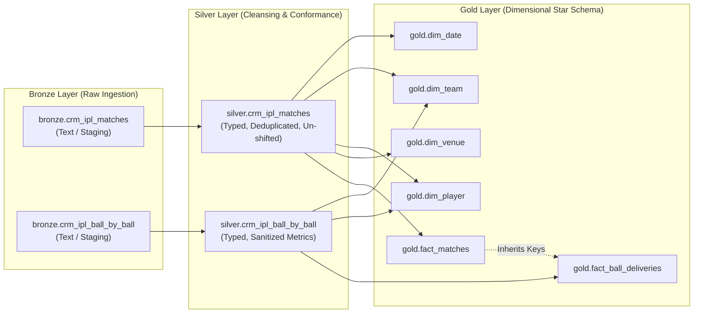
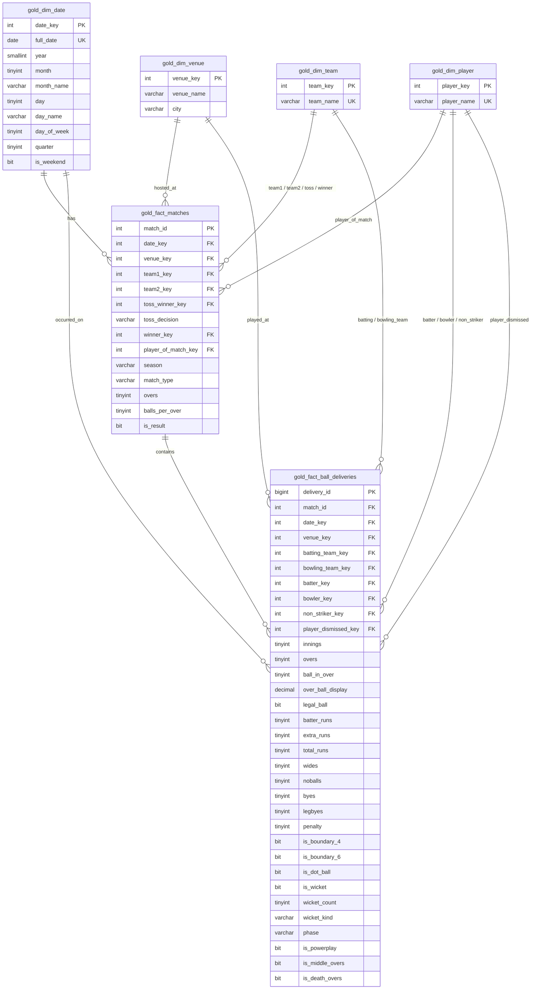

# IPL Data Warehouse Data Catalog

## 1. Overview & Architecture

* **Database Engine**: Microsoft SQL Server 2022 / Azure SQL Database
* **Database Name**: `Datawarehouse`
* **Architecture Pattern**: Medallion Data Architecture (Bronze → Silver → Gold Star Schema)
* **Domain**: Indian Premier League (IPL) Cricket Analytics (2008 – Present)

### Architecture Lineage



---

## 2. Gold Layer (Star Schema Model)

The Gold layer models IPL data at two distinct grains:
1. **Match-Level Grain**: `gold.fact_matches` (1 row per match)
2. **Ball-Delivery Grain**: `gold.fact_ball_deliveries` (1 row per ball delivered)

### Star Schema Entity-Relationship Diagram



---

## 3. Data Dictionary: Gold Layer (Production Mart)

### 3.1. Dimension: `gold.dim_date`
* **Grain**: 1 row per unique calendar date
* **Primary Key**: `date_key` (Format: `YYYYMMDD`)

| Column Name | Data Type | Nullable | Description / Business Logic |
| :--- | :--- | :--- | :--- |
| `date_key` | `INT` | No | Smart surrogate key in `YYYYMMDD` format (e.g., `20170405`). |
| `full_date` | `DATE` | No | Full ISO calendar date (`YYYY-MM-DD`). Unique index. |
| `year` | `SMALLINT` | No | Calendar year (e.g., `2008`–`2026`). |
| `month` | `TINYINT` | No | Calendar month index (`1`–`12`). |
| `month_name` | `VARCHAR(15)` | No | Name of the month (e.g., `'April'`, `'May'`). |
| `day` | `TINYINT` | No | Day of month (`1`–`31`). |
| `day_name` | `VARCHAR(15)` | No | Name of the day (e.g., `'Monday'`, `'Saturday'`). |
| `day_of_week`| `TINYINT` | No | Day index of the week (`1` = Sunday, `7` = Saturday). |
| `quarter` | `TINYINT` | No | Calendar quarter (`1`–`4`). |
| `is_weekend` | `BIT` | No | Flag: `1` if Saturday or Sunday, else `0`. |

---

### 3.2. Dimension: `gold.dim_team`
* **Grain**: 1 row per standardized IPL franchise
* **Primary Key**: `team_key` (Identity)

| Column Name | Data Type | Nullable | Description / Business Logic |
| :--- | :--- | :--- | :--- |
| `team_key` | `INT` | No | Surrogate key auto-generated via `IDENTITY(1,1)`. |
| `team_name` | `VARCHAR(50)` | No | Conformed, standardized IPL franchise name (Unique). Rebrands are harmonized. |

#### Standardized Franchise Master (15 Franchises):
* Chennai Super Kings
* Delhi Capitals *(includes historic Delhi Daredevils)*
* Gujarat Titans
* Gujarat Lions
* Kolkata Knight Riders
* Lucknow Super Giants
* Mumbai Indians
* Punjab Kings *(includes historic Kings XI Punjab)*
* Rajasthan Royals
* Rising Pune Supergiant *(includes Rising Pune Supergiants)*
* Royal Challengers Bengaluru *(includes Royal Challengers Bangalore)*
* Sunrisers Hyderabad
* Deccan Chargers
* Kochi Tuskers Kerala
* Pune Warriors

---

### 3.3. Dimension: `gold.dim_player`
* **Grain**: 1 row per unique cricket player
* **Primary Key**: `player_key` (Identity)

| Column Name | Data Type | Nullable | Description / Business Logic |
| :--- | :--- | :--- | :--- |
| `player_key` | `INT` | No | Surrogate key auto-generated via `IDENTITY(1,1)`. |
| `player_name`| `VARCHAR(100)`| No | Official player full name (e.g., `'V Kohli'`, `'MS Dhoni'`, `'JJ Bumrah'`). |

---

### 3.4. Dimension: `gold.dim_venue`
* **Grain**: 1 row per unique stadium and hosting city
* **Primary Key**: `venue_key` (Identity)

| Column Name | Data Type | Nullable | Description / Business Logic |
| :--- | :--- | :--- | :--- |
| `venue_key` | `INT` | No | Surrogate key auto-generated via `IDENTITY(1,1)`. |
| `venue_name` | `VARCHAR(150)`| No | Standardized stadium name (e.g., `'Wankhede Stadium'`, `'Eden Gardens'`). |
| `city` | `VARCHAR(50)` | Yes | City name hosting the venue (e.g., `'Mumbai'`, `'Kolkata'`, `'Dubai'`). |

---

### 3.5. Fact: `gold.fact_matches`
* **Grain**: 1 row per scheduled match
* **Primary Key**: `match_id`

| Column Name | Data Type | Nullable | Foreign Key Reference | Description |
| :--- | :--- | :--- | :--- | :--- |
| `match_id` | `INT` | No | PK | Official match identifier. |
| `date_key` | `INT` | No | `gold.dim_date(date_key)` | Date when match was played. |
| `venue_key` | `INT` | No | `gold.dim_venue(venue_key)` | Venue where match took place. |
| `team1_key` | `INT` | No | `gold.dim_team(team_key)` | First participating team. |
| `team2_key` | `INT` | No | `gold.dim_team(team_key)` | Second participating team. |
| `toss_winner_key` | `INT` | No | `gold.dim_team(team_key)` | Franchise that won the toss. |
| `toss_decision` | `VARCHAR(10)` | No | — | Toss decision (`'bat'` or `'field'`). |
| `winner_key` | `INT` | Yes | `gold.dim_team(team_key)` | Franchise that won the match (`NULL` if No Result). |
| `player_of_match_key` | `INT` | Yes | `gold.dim_player(player_key)` | Official Man of the Match recipient (`NULL` if none). |
| `season` | `VARCHAR(10)` | No | — | Tournament season/edition (e.g., `'2023'`, `'2020/21'`). |
| `match_type` | `VARCHAR(20)` | No | — | Match format (defaults to `'T20'`). |
| `overs` | `TINYINT` | No | — | Scheduled overs per innings (defaults to `20`). |
| `balls_per_over` | `TINYINT` | No | — | Legal deliveries per over (defaults to `6`). |
| `is_result` | `BIT` | No | — | `1` if match produced a definitive winner, `0` if tied/abandoned. |

---

### 3.6. Fact: `gold.fact_ball_deliveries`
* **Grain**: 1 row per individual ball delivery
* **Primary Key**: `delivery_id` (BIGINT Identity)

| Column Name | Data Type | Nullable | Foreign Key Reference | Description |
| :--- | :--- | :--- | :--- | :--- |
| `delivery_id` | `BIGINT` | No | PK | Unique delivery surrogate identifier. |
| `match_id` | `INT` | No | `gold.fact_matches(match_id)` | Parent match identifier. |
| `date_key` | `INT` | No | `gold.dim_date(date_key)` | Inherited date key from match. |
| `venue_key` | `INT` | No | `gold.dim_venue(venue_key)` | Inherited venue key from match. |
| `batting_team_key` | `INT` | No | `gold.dim_team(team_key)` | Team currently at the crease. |
| `bowling_team_key` | `INT` | No | `gold.dim_team(team_key)` | Team delivering the over. |
| `batter_key` | `INT` | No | `gold.dim_player(player_key)` | Striker facing delivery. |
| `bowler_key` | `INT` | No | `gold.dim_player(player_key)` | Bowler delivering the ball. |
| `non_striker_key` | `INT` | No | `gold.dim_player(player_key)` | Non-striker partner at opposite crease. |
| `player_dismissed_key`| `INT` | Yes | `gold.dim_player(player_key)` | Dismissed cricketer on a wicket event (`NULL` if no wicket). |
| `innings` | `TINYINT` | No | — | Innings number (`1`, `2`, or `3`/`4` for super overs). |
| `overs` | `TINYINT` | No | — | Over index (`0` to `19`). |
| `ball_in_over` | `TINYINT` | No | — | Ball number within the over (`1` to `10+` with extras). |
| `over_ball_display` | `DECIMAL(4,1)`| Yes | — | Over.Ball display notation (e.g., `0.1`, `19.6`). |
| `legal_ball` | `BIT` | No | — | `1` if ball counts toward the 6-ball over count, `0` if extra. |
| `batter_runs` | `TINYINT` | No | — | Runs scored strictly off the bat. |
| `extra_runs` | `TINYINT` | No | — | Extras awarded on delivery. |
| `total_runs` | `TINYINT` | No | — | `batter_runs + extra_runs`. |
| `wides` | `TINYINT` | No | — | Wide penalty runs. |
| `noballs` | `TINYINT` | No | — | No-ball penalty runs. |
| `byes` | `TINYINT` | No | — | Bye runs scored. |
| `legbyes` | `TINYINT` | No | — | Leg bye runs scored. |
| `penalty` | `TINYINT` | No | — | Special penalty runs. |
| `is_boundary_4` | `BIT` | No | — | Flag: `1` if boundary four scored. |
| `is_boundary_6` | `BIT` | No | — | Flag: `1` if boundary six scored. |
| `is_dot_ball` | `BIT` | No | — | Flag: `1` if zero runs scored on legal ball. |
| `is_wicket` | `BIT` | No | — | Flag: `1` if dismissal occurred. |
| `wicket_count` | `TINYINT` | No | — | Count of wickets on delivery (usually `1` or `0`). |
| `wicket_kind` | `VARCHAR(50)` | Yes | — | Dismissal type (`'bowled'`, `'caught'`, `'run out'`, `'lbw'`). |
| `phase` | `VARCHAR(20)` | Yes | — | Match phase: `'Powerplay'`, `'Middle'`, `'Death'`. |
| `is_powerplay` | `BIT` | No | — | Flag: `1` if overs 0–5. |
| `is_middle_overs` | `BIT` | No | — | Flag: `1` if overs 6–14. |
| `is_death_overs` | `BIT` | No | — | Flag: `1` if overs 15–19. |

---

## 4. Silver Layer (Cleaned & Standardized)

The Silver layer enforces strict typing, cleans corrupt shifts, resolves missing cities, and filters duplicates.

### 4.1. Table: `silver.crm_ipl_matches`
* **Source**: `bronze.crm_ipl_matches`
* **Grain**: 1 row per unique match (`match_id` PK)

| Column Name | Data Type | Constraints / Business Rules |
| :--- | :--- | :--- |
| `match_id` | `INT PRIMARY KEY` | Deduplicated via `ROW_NUMBER() OVER (PARTITION BY match_id)`. |
| `match_date` | `DATE NOT NULL` | Converted from `DD-MM-YYYY` string using style `105`. |
| `season` | `VARCHAR(10) NOT NULL` | Trimmed season string. |
| `city` | `VARCHAR(50) NULL` | Imputed: Dubai/Sharjah if venue contains UAE keywords; 'Bangalore' → 'Bengaluru'. |
| `venue` | `VARCHAR(150) NOT NULL`| Stripped of surrounding quotes (`"`). |
| `team1` | `VARCHAR(50) NOT NULL` | Franchise harmonized. |
| `team2` | `VARCHAR(50) NOT NULL` | Franchise harmonized. |
| `toss_winner` | `VARCHAR(50) NOT NULL` | Franchise harmonized. |
| `toss_decision`| `VARCHAR(10) NOT NULL`| Standardized to lowercase (`'bat'` or `'field'`). |
| `winner` | `VARCHAR(50) NULL` | Harmonized franchise name; `'No Result'` and `'Unknown'` set to `NULL`. |
| `player_of_match`| `VARCHAR(50) NULL` | Trimmed player name; `'Unknown'` set to `NULL`. |
| `match_type` | `VARCHAR(20) NOT NULL`| Trimmed match type. |
| `overs` | `TINYINT NOT NULL` | Cast from text; defaults to `20`. |
| `balls_per_over`| `TINYINT NOT NULL` | Cast from text; defaults to `6`. |

### 4.2. Table: `silver.crm_ipl_ball_by_ball`
* **Source**: `bronze.crm_ipl_ball_by_ball`
* **Grain**: 1 row per delivery (`match_id, innings, overs, ball_in_over`)

| Column Name | Data Type | Constraints / Business Rules |
| :--- | :--- | :--- |
| `match_id` | `INT NOT NULL` | Foreign reference to matches. |
| `match_date` | `DATE NOT NULL` | Validated match date. |
| `season` | `VARCHAR(10) NOT NULL` | Trimmed season. |
| `city` | `VARCHAR(50) NULL` | Normalized city name. |
| `venue` | `VARCHAR(150) NOT NULL`| Cleaned stadium name. |
| `team1`, `team2` | `VARCHAR(50) NOT NULL`| Standardized franchise names. |
| `batting_team`, `bowling_team` | `VARCHAR(50) NOT NULL` | Standardized franchise names. |
| `innings`, `overs`, `ball_in_over` | `TINYINT NOT NULL` | Numeric delivery coordinates; deduplicated. |
| `legal_ball` | `BIT NOT NULL` | Converted from boolean/string (`'1'`, `'TRUE'`). |
| `batter_runs` .. `penalty` | `TINYINT NOT NULL` | Missing/NULL values replaced with `0`. |
| `is_boundary_4` .. `is_wicket` | `BIT NOT NULL` | Standardized to `1`/`0` bit flags. |
| `wicket_player_out`, `wicket_kind` | `VARCHAR NULL` | Blank strings converted to SQL `NULL`. |

---

## 5. Bronze Layer (Raw Staging)

Raw staging tables configured as ingested from CSV/Excel flat files.

* **`bronze.crm_ipl_matches`**: Staging table storing unparsed match strings (`match_date` as `VARCHAR(MAX)`, all categorical fields as `NVARCHAR(MAX)`).
* **`bronze.crm_ipl_ball_by_ball`**: Staging table storing all 50 ball-level metrics as `NVARCHAR(MAX)`.

---

## 6. Data Cleansing Transformations & Rules Catalog

1. **CSV Comma Shift Auto-Healing**:
   Raw flat file imports occasionally split stadium names containing commas (e.g. `"Rajiv Gandhi International Stadium, Uppal"`). The Silver loader automatically checks if `venue LIKE '"%'` and reconstructs the stadium string while shifting remaining team and toss columns back to their true positions.
2. **Franchise Normalization Mapping**:
   * `'Delhi Daredevils'` → `'Delhi Capitals'` (Rebranded in 2018)
   * `'Kings XI Punjab'` → `'Punjab Kings'` (Rebranded in 2021)
   * `'Rising Pune Supergiants'` → `'Rising Pune Supergiant'` (Single letter drop in 2017)
   * `'Royal Challengers Bangalore'` → `'Royal Challengers Bengaluru'` (Rebranded in 2024)
3. **Missing City Imputation**:
   * Venues containing `'Dubai'` with city `'Unknown'` are mapped to `'Dubai'`.
   * Venues containing `'Sharjah'` with city `'Unknown'` are mapped to `'Sharjah'`.
   * Old city spellings like `'Bangalore'` are conformed to `'Bengaluru'`.
4. **Sentinel String to NULL Mapping**:
   * Text values `'No Result'`, `'Unknown'`, or empty strings `''` in outcome columns (`winner`, `player_of_match`, `wicket_player_out`) are converted to database `NULL`.
5. **Numerical Safeguards**:
   * All run attributes (`batter_runs`, `extra_runs`, `wides`, `noballs`, `byes`, `legbyes`, `penalty`) default to `0` instead of `NULL`.
   * Match format variables default to standard T20 values (`overs = 20`, `balls_per_over = 6`).

---

## 7. Pipeline Execution & Maintenance

To execute or refresh the data warehouse pipeline in SSMS:

```sql
USE Datawarehouse;
GO

-- 1. Ingest Bronze to Silver
EXEC silver.load_silver;
GO

-- 2. Populate Gold Star Schema (Facts & Dimensions)
-- Run the Gold Population Script
EXEC gold.load_star_schema;
GO
```

---

## 8. Verification & Health Check Queries

```sql
USE Datawarehouse;
GO

-- 1. Table Row Counts
SELECT 'dim_date' AS [Table], COUNT(*) AS [Rows] FROM gold.dim_date
UNION ALL SELECT 'dim_team', COUNT(*) FROM gold.dim_team
UNION ALL SELECT 'dim_player', COUNT(*) FROM gold.dim_player
UNION ALL SELECT 'dim_venue', COUNT(*) FROM gold.dim_venue
UNION ALL SELECT 'fact_matches', COUNT(*) FROM gold.fact_matches
UNION ALL SELECT 'fact_ball_deliveries', COUNT(*) FROM gold.fact_ball_deliveries;

-- 2. Foreign Key Integrity Check (Must return 0)
SELECT COUNT(*) AS OrphanDeliveries
FROM gold.fact_ball_deliveries f
LEFT JOIN gold.fact_matches m ON f.match_id = m.match_id
WHERE m.match_id IS NULL;
```
